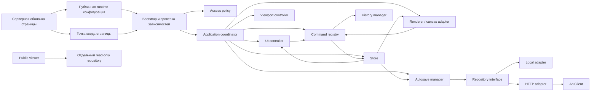

# Карта паттернов приложения

Документ фиксирует общие решения MoodBoards, которые можно использовать как основу для другого интерактивного веб-приложения. Это не инструкция по копированию конкретного редактора: доменные имена, URL, PHP, jQuery, Konva и IndexedDB являются заменяемыми реализациями.

## 1. Базовая архитектурная карта



Основное направление зависимостей: инфраструктура зависит от контрактов приложения, а прикладная логика не должна зависеть от конкретного способа хранения, DOM-библиотеки или графического движка.

## 2. Главные принципы

| Приоритет | Паттерн | Правило |
|---|---|---|
| Обязательно | Единственный источник истины | Сохраняемое состояние находится в доменной модели, а DOM/canvas является её проекцией. |
| Обязательно | Разделение domain и UI state | Selection, открытые popover, viewport и loading-состояния не записываются в бизнес-документ без отдельного требования. |
| Обязательно | Изменения через команды | Любое пользовательское изменение проходит одним маршрутом и получает undo/redo, autosave и понятное имя операции. |
| Обязательно | Контракт хранения | UI работает с repository interface, а не с IndexedDB, `fetch()` или SQL напрямую. |
| Обязательно | Валидация на границах | Данные проверяются при загрузке, импорте, миграции и перед сохранением. |
| Обязательно | Явный lifecycle | Каждый долгоживущий модуль имеет `init()`/`destroy()` или эквивалент и освобождает свои ресурсы. |
| Рекомендуется | Тонкие контроллеры | Сложные расчёты выносятся в чистые функции и небольшие сервисы. |
| Рекомендуется | Runtime-конфигурация | URL, лимиты, драйверы и таймауты приходят извне и не размазаны по модулям. |
| Рекомендуется | Progressive enhancement | Сервер отдаёт осмысленную оболочку, клиент явно сообщает об ошибке bootstrap. |
| Для публичных экранов | Least privilege | Read-only экран получает отдельный минимальный контракт, а не полный приватный repository. |

## 3. Слои приложения

### 3.1. Server shell

Отвечает только за:

- HTML-каркас и доступную начальную разметку;
- подключение локальных runtime-зависимостей;
- безопасную сериализацию публичной конфигурации;
- серверные guard и proxy, если они действительно нужны.

В шаблон страницы не следует переносить бизнес-логику, секреты и прямые операции с данными пользователя.

### 3.2. Bootstrap и entry point

У каждой страницы одна небольшая точка входа. Она:

1. Проверяет обязательные зависимости.
2. Получает runtime-конфигурацию.
3. Проверяет доступ пользователя.
4. Создаёт адаптеры через factory.
5. Собирает главный application coordinator.
6. Запускает `init()` и централизованно обрабатывает ошибку старта.

Точка входа не должна содержать прикладные сценарии.

### 3.3. Application coordinator

Координатор связывает store, UI, renderer, команды, autosave и repository. Он управляет сценарием страницы, но не должен выполнять сложные геометрические вычисления, рисовать DOM или реализовывать HTTP-протокол.

Для большого приложения координатор следует декомпозировать по use case: загрузка, редактирование, импорт, экспорт, публикация и восстановление.

### 3.4. Store

Store хранит текущее согласованное состояние и рассылает типизированные события подписчикам.

Правила:

- наружу возвращаются копии, а не изменяемые внутренние ссылки;
- запись проходит через ограниченный набор методов;
- domain state и UI state различаются явно;
- событие сообщает, что изменилось, но не заставляет подписчика повторно вычислять весь экран;
- загрузка и замена документа всегда запускают валидацию.

### 3.5. Command pattern

Команда является единственной точкой бизнес-изменения документа.

```text
UI gesture → command → validation → store update → history → render → autosave
```

Один продолжительный жест создаёт одну запись истории: промежуточные `dragmove`/`input` обновляют preview, а commit выполняется на `dragend`, `transformend`, `change` или явное подтверждение.

Команда должна содержать:

- входные данные;
- проверку предусловий;
- детерминированное изменение;
- данные для отмены либо снимок минимально затронутой области;
- человекочитаемое название для истории и диагностики.

### 3.6. Renderer adapter

Графический движок или DOM renderer не является источником истины. Адаптер:

- строит представление из domain state;
- преобразует жесты пользователя в намерения/команды;
- не сохраняет служебные свойства движка в документ;
- обновляет только изменённые узлы;
- отделяет content layer от UI layer;
- восстанавливает состояние после временных export/preview операций.

Для canvas-приложений отдельно учитываются DPR, browser zoom, кэширование растровых узлов, ожидание шрифтов/изображений и недопустимость canvas размером `0×0`.

### 3.7. Viewport controller

Pan, zoom, fit и перевод координат образуют отдельную подсистему. Бизнес-объекты хранятся в мировых координатах; текущий viewport является временным UI state и не должен менять геометрию документа.

## 4. Данные и сохранение

### 4.1. Версионируемый документ

Каждый сохраняемый документ содержит `schemaVersion`. Изменение схемы требует одновременно:

- миграции старых версий;
- валидации новой версии;
- обновления документации контракта;
- тестов чтения старой и новой схемы;
- проверки импорта повреждённых данных.

Порядок элементов массива может быть значимым бизнес-данным. В MoodBoards он определяет Z-index; в другом приложении это может быть порядок задач, шагов или секций.

### 4.2. Отдельные assets

Большие бинарные данные хранятся отдельно от JSON и связываются непрозрачным `assetId`. Это даёт:

- небольшие документы и дешёвые снимки истории;
- независимую загрузку и кэширование;
- возможность заменить локальное хранилище серверным;
- явную каскадную очистку неиспользуемых ресурсов.

Repository должен определять владение asset, правила удаления и поведение при отсутствующем Blob.

### 4.3. Revision и конфликты

Сохранение принимает ожидаемую revision и возвращает новую. Конфликт не маскируется повторной записью: он преобразуется в отдельную ошибку, после которой приложение предлагает reload, merge или восстановление черновика.

### 4.4. Autosave как state machine

Autosave не является одиночным таймером. Рекомендуемые состояния:

```text
idle → dirty → scheduled → saving → saved
                         ↘ retrying → saving
                         ↘ error
```

Инварианты:

- одновременно выполняется не более одной записи;
- изменение во время записи создаёт следующий pending snapshot;
- retry разрешён только для временных и безопасно повторяемых ошибок;
- статус сохранения не меняет размеры соседних UI-блоков;
- `pagehide`/`visibilitychange` инициируют best-effort flush;
- `beforeunload` применяется только во время реальной записи или при отсутствии надёжного локального черновика.

### 4.5. Crash recovery

Последнее несохранённое состояние синхронно фиксируется в небольшом локальном draft. После успешного устойчивого сохранения draft удаляется. Восстановление разрешено только после проверки идентификатора документа, revision, времени и schemaVersion.

## 5. Repository и API

### 5.1. Repository interface

Контракт описывает операции предметной области, а не детали транспорта:

```js
repository.list()
repository.create(data)
repository.get(id)
repository.updateMeta(id, patch)
repository.saveContent(id, document, revision)
repository.delete(id)
repository.addAsset(ownerId, blob)
repository.getAsset(assetId)
repository.deleteAsset(assetId)
repository.savePreview(id, blobOrNull)
```

Методы асинхронны и возвращают одинаковые структуры для всех драйверов. Ошибки нормализуются в стабильные коды, например `NOT_FOUND`, `CONFLICT`, `VALIDATION_ERROR`, `NETWORK_ERROR`.

### 5.2. Abstract factory

`RepositoryFactory` выбирает драйвер из runtime-конфигурации и проверяет его интерфейс при создании. Переход с локального прототипа на HTTP не должен требовать изменений UI и прикладных сценариев.

### 5.3. ApiClient

Единый transport client отвечает за:

- base URL и same-origin credentials;
- JSON и бинарные ответы;
- timeout и отмену через `AbortSignal`;
- CSRF для изменяющих запросов;
- `X-Request-Id` для диагностики;
- idempotency key для повторяемых mutation;
- ограниченный retry с backoff и `Retry-After`;
- преобразование HTTP/network ошибок в единый тип.

Repository не должен самостоятельно дублировать эту логику.

### 5.4. Отдельный public contract

Публичный viewer получает только методы чтения, например `getSnapshot(token)` и `getAsset(token, assetId)`. Приватные create/update/delete методы не должны быть доступны даже как неиспользуемые свойства объекта.

### 5.5. Специальный технический режим

В MoodBoards query-параметр `mode=view` включает диагностические возможности, скрытые в обычном интерфейсе. Несмотря на название, это не публичный read-only viewer и не замена странице `view.php`.

```text
/moodboards/index.php?mode=view
/moodboards/editor.php?id={id}&mode=view
```

Если в URL уже есть параметры, режим добавляется через `&mode=view`. Его фактический признак — `body.moodboards-demo-mode`; определение режима централизовано в `isMoodboardsDemoMode()`, а не повторяется в компонентах.

| Возможность | Обычный режим | `mode=view` |
|---|---:|---:|
| Рабочий интерфейс списка/редактора | Да | Да |
| Переключатель демонстрационного тарифа | Нет | Да |
| Выбор серверного пресета удаления фона | Нет | Да |
| Импорт/экспорт полного проекта в JSON в редакторе | Нет | Да |
| Техническая корректировка overlay-слоёв для debug-панели | Нет | Да |
| Обход авторизации, тарифа или серверной валидации | Нет | Нет |

Связанные параметры:

- `mock_tariff=guest|free|basic|premium|pro` — эмуляция тарифного сценария;
- `mock_preset=preset_0|preset_1|preset_01|preset_02|preset_03` — выбор идентификатора пресета удаления фона;
- `id={id}` — редактируемый проект; не является параметром технического режима.

Правила реализации технического режима:

- дополнительные элементы отсутствуют или скрыты по умолчанию и не занимают место в layout;
- feature flag вычисляется в одном модуле и отражается одним атрибутом/классом корневого элемента;
- техническая панель имеет собственный именованный z-index, а уведомления показываются выше неё;
- параметры сохраняются при навигации только там, где это нужно для тестового сценария;
- debug UI не содержит секретов и не предоставляет операции, которых пользователь не может выполнить через проверяемый repository/API;
- режим не отменяет access policy, серверную авторизацию, CSRF, лимиты и валидацию;
- публичный `view.php` не показывает техническую панель даже при наличии `mode=view`;
- production-сборка должна уметь полностью отключить такой режим серверной конфигурацией или разрешить его только уполномоченным пользователям.

Для другого приложения URL-флаг подходит для локального прототипа и QA. В production предпочтительнее явный runtime feature flag, связанный с окружением и правами пользователя.

## 6. CSS и визуальная система

### 6.1. Три уровня токенов

```text
Базовые токены → семантические aliases → локальные переменные компонента
```

Пример:

```css
:root {
    --primary-0: #3183ff;
    --stroke-1: #dfdfdf;
    --model-fill: #fff;

    --color-accent: var(--primary-0);
    --color-border: var(--stroke-1);
    --color-surface: var(--model-fill);

    --radius-sm: 8px;
    --control-height: 40px;
    --transition-fast: 140ms ease;
}
```

Компоненты используют семантические переменные. Тема переопределяет aliases на корневом контейнере, не переписывая каждый компонент.

### 6.2. Разделение CSS

- `base.css`: reset, типографика, токены, общие кнопки, формы, состояния и accessibility utilities;
- CSS страницы: layout и компоненты конкретного экрана;
- локальные переменные компонента: только если значение не является общим дизайн-токеном.

Не следует создавать глобальный класс для единичной детали или помещать page layout в `base.css`.

### 6.3. Нормативные правила оформления UI-компонентов

Все новые компоненты собираются из общих токенов и следуют единой геометрии. Произвольные размеры, цвета и тени допускаются только после добавления соответствующего токена или обоснованной локальной переменной компонента.

#### Размеры и ритм

- Базовая сетка отступов — `4px`; типовые значения: `4`, `8`, `12`, `16`, `24`, `32px`.
- Высота однотипных контролов в одной панели одинакова. Рекомендуемые уровни: compact `32px`, default `40px`, large `48px`.
- Минимальная интерактивная область — `40×40px`; визуально маленькая иконка может иметь увеличенную невидимую область нажатия.
- Внутренний отступ и gap задаются контейнером, а не внешними margin у каждого потомка.
- Текст и иконки центрируются flex/grid-механикой; позиционирование через случайные `top`, `left` и отрицательные margin не используется.
- Динамический текст не должен менять геометрию соседних элементов: применяется фиксированная колонка, `min-width: 0`, ellipsis либо зарезервированная ширина.

#### Типографика

- Компонент наследует основное семейство шрифта; альтернативное семейство применяется только через семантический typography token.
- Размер, line-height и weight задаются согласованным пресетом, например body, caption, label, heading, а не уникальной комбинацией в каждом компоненте.
- Текст кнопки не переносится, если перенос не предусмотрен её макетом.
- Placeholder и вторичный текст имеют меньший контраст, но остаются читаемыми; placeholder не заменяет видимый label.
- Для числовых значений, процентов и размеров резервируется ширина под максимальное ожидаемое значение.

#### Кнопки и icon buttons

- Базовые варианты: primary, secondary, ghost и danger. Создание нового визуального варианта требует повторяемого сценария, а не одного экрана.
- Внутри варианта сохраняются одинаковые height, radius, font и горизонтальные padding.
- Icon-only кнопки квадратные; SVG обычно имеет размер `18–24px`, наследует цвет через `currentColor` и не содержит жёстко заданную тему внутри `stroke`/`fill`.
- Иконка с текстом имеет постоянный gap; иконка не сжимается через `flex-shrink`.
- Стрелка раскрытия занимает отдельную фиксированную область и центрируется независимо от длины label.
- Disabled-кнопка сохраняет размеры, не реагирует на hover/active и не запускает обработчик.
- Loading не заменяет кнопку элементом другой ширины: индикатор отображается внутри исходной геометрии.

#### Поля, select и переключатели

- Видимый label связан с контролом через `for`/`id`; дополнительное описание — через `aria-describedby`.
- Input, select и textarea используют общие border, radius, background, text и focus tokens.
- Нативный select нормализуется через `appearance` и собственную фиксированную область стрелки; текст не должен заходить под стрелку.
- Focus подсвечивает границу или внешний ring самого контрола, но не создаёт двойную толстую рамку вокруг вложенного input.
- Ошибка показывается не только цветом: добавляются текст, `aria-invalid="true"` и связь с сообщением.
- Switch изменяет настоящее состояние контрола, поддерживает клавиатуру и не реализуется декоративным `div` без роли.

#### Toolbar и action panel

- Панель имеет одну высоту, общий фон, radius, shadow и внутренний gap; группы действий разделяются семантическим separator.
- Часто используемые действия видимы, вторичные уходят в меню дополнительных действий.
- Порядок действий стабилен между родственными типами объектов: свойства → разделитель → копирование/слои → удаление → дополнительные действия.
- Панель не перекрывает выбранный объект и не выходит за viewport; при нехватке места меняет сторону размещения либо получает собственный горизонтальный overflow.
- Появление панели не сдвигает основной layout, поскольку она располагается в overlay-слое.
- Недоступная команда остаётся на ожидаемом месте в disabled-состоянии, если исчезновение вызовет скачок или нарушит узнаваемость панели.

#### Карточки, списки и empty state

- Карточки одного списка имеют одинаковую структуру; превью использует стабильный aspect ratio и `object-fit` согласно сценарию.
- Длинное название сокращается визуально, но полное значение доступно через tooltip или доступное имя.
- Hover не меняет толщину border; для подсветки используется заранее существующая прозрачная граница, фон или inset-shadow.
- Empty state объясняет причину пустоты и предлагает одно основное следующее действие.
- Loading state по возможности повторяет геометрию будущего контента через skeleton или резервирование размеров.
- Повреждённый или отсутствующий asset получает устойчивый placeholder и действие восстановления, не ломая сетку списка.

#### Tooltip, popover, menu и dialog

- Tooltip содержит только короткое пояснение; действия и формы размещаются в popover/menu/dialog.
- Tooltip не является единственным способом передать критичную информацию и не содержит подсказки горячей клавиши, если продуктом принято показывать их отдельно.
- Popover визуально связан с trigger, но его декоративная стрелка не участвует в расчёте размеров и не смещает содержимое.
- Menu item имеет стабильную высоту, иконку в фиксированной колонке и ясно различимые hover, focus, selected и disabled.
- Dialog содержит заголовок, область содержимого и согласованный footer; основное действие располагается стабильно, опасное действие визуально отличается.
- Z-index берётся из именованной шкалы слоёв: canvas UI, floating panel, popover, modal backdrop, modal, toast.

#### Feedback-компоненты

- Toast/notification располагается в выделенном overlay-контейнере и остаётся выше служебных/debug-панелей.
- Success, warning и error различаются иконкой и текстом, а не только цветом.
- Для длительной операции показываются этап или progress и возможность отмены, если операция отменяема.
- Autosave отображается компактным текстовым статусом без фона и скачка ширины; состояния минимум: изменено, сохранение, сохранено, ошибка.
- Ошибка предлагает следующее действие: повторить, восстановить, перезагрузить или открыть детали.

#### Темы, контраст и визуальная устойчивость

- Компонент не содержит прямых `#fff`/`#000`, если это не зафиксированный цвет бренда или контента; используются semantic surface/text/icon tokens.
- Тёмная тема проверяется для текста, SVG, border, shadow, disabled, focus и overlay, а не только для фоновых поверхностей.
- Контраст обычного текста — не ниже `4.5:1`, крупного текста и значимых графических контролов — не ниже `3:1`.
- Hover, focus и selected визуально различимы и могут существовать одновременно.
- Border, scrollbar, системные select и number input проверяются в Chrome, Edge и Firefox.
- Анимации изменяют преимущественно opacity/transform и не должны вызывать layout shift.

#### Именование и организация CSS

- Компонент имеет собственный namespace, например `.layer-map`, `.layer-map__search`, `.layer-map--collapsed`.
- Модификаторы описывают вариант, `data-state` — текущее состояние; состояние не кодируется случайным inline-style.
- Селекторы остаются короткими и с низкой специфичностью; `!important` допускается только для документированной utility или интеграционного override.
- JavaScript меняет класс/атрибут состояния, а не набор отдельных CSS-свойств.
- Общий компонент сначала расширяется вариантом; копия его CSS для другой страницы не создаётся.

### 6.4. Стабильный DOM-контракт

| Атрибут | Назначение |
|---|---|
| `class` | Внешний вид и layout. |
| `data-role` | Поиск важного узла контроллером или тестом. |
| `data-action` | Делегированное пользовательское действие. |
| `data-state` / `data-status` | Состояние state machine для CSS и диагностики. |
| `data-setting` | Привязка настройки к UI. |
| `aria-*` | Семантика, доступность и фактическое состояние контрола. |

JS не должен зависеть от декоративной вложенности или CSS-класса, если для узла можно задать стабильный `data-role`.

### 6.5. Состояния интерактивного элемента

Каждый контрол проектируется сразу со всеми состояниями:

| Состояние | Требование |
|---|---|
| Default | Достаточная контрастность и стабильный размер. |
| Hover | Изменение цвета/фона без сдвига layout. |
| Active | Краткая визуальная обратная связь. |
| Selected/pressed | Отдельно от hover; синхронизируется с `aria-pressed` или `aria-selected`. |
| Disabled | Нельзя активировать мышью и клавиатурой; курсор `not-allowed`. |
| Loading | Блокировка повторного запуска, spinner/progress и `aria-busy`. |
| Error | Текстовая причина, `role="alert"`, действие повтора где уместно. |
| Focus visible | Хорошо заметный focus ring только для клавиатурной навигации. |

Граница, font weight и появление текста не должны менять размеры контрола. Для динамического статуса заранее резервируется достаточная область либо применяется фиксированная сеточная колонка.

### 6.6. Popover, menu и dialog

- Trigger хранит `aria-expanded`, `aria-controls` и корректный `aria-haspopup`.
- Popover позиционируется относительно владельца, но ограничивается viewport.
- Открытие взаимоисключающего overlay закрывает предыдущий.
- Клик снаружи и `Escape` закрывают временный overlay.
- Dialog имеет `aria-modal`, label/description, начальный focus и возврат focus на trigger.
- Удаление и другие необратимые действия требуют `alertdialog` или явного confirm.
- Overlay не должен перекрывать свой trigger и критичные плавающие панели.

### 6.7. Responsive и desktop-first

Сначала определяется полноценная desktop-композиция, затем правила сжатия:

1. Сокращение необязательного текста.
2. Ограничение длинных названий через `min-width: 0`, ellipsis и tooltip.
3. Перенос вторичных действий в overflow menu.
4. Горизонтальный scroll внутри собственной панели, а не у всей страницы.
5. Ограничение popover через `max-width`, `max-height` и viewport-aware positioning.
6. Явный блокирующий экран только ниже официально поддерживаемой ширины.

Минимальная матрица визуальной проверки: 500, 1024, 1280, 1440 и 1920 px, светлая и тёмная темы, длинные названия, пустое и переполненное состояние.

### 6.8. Accessibility

- Icon-only кнопка всегда имеет `aria-label`.
- Декоративная SVG получает `aria-hidden="true"`.
- Loading/status использует `role="status"` и подходящий `aria-live`.
- Ошибка использует `role="alert"`.
- Горячие клавиши не перехватываются внутри `input`, `textarea`, `select` и `contenteditable`.
- Управление доступно мышью и клавиатурой.
- Цвет не является единственным признаком состояния.
- Учитывается `prefers-reduced-motion` для необязательной анимации.

## 7. UI-контроллеры и события

Для DOM с большим количеством повторяемых элементов используется делегирование событий от стабильного root. jQuery namespace или аналогичный AbortController позволяет снять весь набор обработчиков в `destroy()`.

Рекомендуемая схема:

```js
class FeatureController {
    init() {
        this.unsubscribe = this.store.subscribe((event) => this.render(event));
        this.root.addEventListener('click', this.handleClick);
    }

    destroy() {
        this.unsubscribe?.();
        this.root.removeEventListener('click', this.handleClick);
        this.abortController.abort();
    }
}
```

Не следует регистрировать обработчики внутри каждого повторного `render()`.

## 8. Асинхронность и ресурсы

Каждая асинхронная операция должна иметь владельца и правило завершения:

- запросы — `AbortController`;
- debounce/retry — сохранённые timer ID;
- object URL — реестр с обязательным `URL.revokeObjectURL()`;
- изображения/canvas — очистка ссылок и временных буферов;
- очереди — ограничение concurrency и `destroy()`;
- `ResizeObserver`, media query и window events — явная отписка;
- устаревший async результат — проверка generation/token перед применением.

Для batch-операций отображается единый progress, а не десятки конкурирующих уведомлений.

## 9. Производительность

Паттерны, применимые к большим интерактивным сценам и спискам:

- reconciliation по ID и fingerprint вместо полного пересоздания;
- lazy hydration тяжёлых assets;
- ограниченная очередь декодирования/загрузки;
- дедупликация параллельных запросов одним Promise;
- `batchDraw`/requestAnimationFrame вместо redraw на каждое событие;
- кэширование только дорогих стабильных узлов;
- отключение растрового кэша при масштабе, на котором он становится размытым;
- очистка невидимых и больше не используемых ресурсов;
- preview/export на отдельном renderer, не меняющем рабочую сцену;
- измерение на целевых объёмах, а не предположение об оптимизации.

## 10. Безопасность и интеграция

- Публичная runtime-конфигурация никогда не содержит секретов.
- Пользовательский текст вставляется через `textContent`/`.text()`, не через HTML.
- URL проходят allowlist протоколов; по умолчанию разрешены только `https:` и при необходимости `http:`.
- Изменяющие HTTP-запросы защищены CSRF и авторизацией на сервере.
- Клиентские тарифные и UI-блокировки не считаются контролем доступа.
- Public token должен быть непрозрачным, отзывным и ограниченным конкретным snapshot/assets.
- Импорт проверяется до записи в repository.
- Размер и MIME файлов повторно проверяются backend, даже если клиент уже выполнил проверку.
- Ошибки наружу имеют безопасное сообщение, а диагностические детали связываются через request ID.

## 11. Рекомендуемая структура нового приложения

```text
app/
├── pages/                 # серверные или статические оболочки
├── assets/
│   ├── css/
│   │   ├── base.css
│   │   └── <page>.css
│   └── js/
│       ├── app-bootstrap.js
│       ├── api/
│       │   └── api-client.js
│       ├── access/
│       ├── models/
│       ├── repositories/
│       │   ├── repository-interface.js
│       │   ├── repository-factory.js
│       │   ├── local-repository.js
│       │   └── http-repository.js
│       ├── settings/
│       └── <feature>/
│           ├── app.js
│           ├── feature-app.js
│           ├── feature-store.js
│           ├── command-registry.js
│           ├── ui-controller.js
│           ├── renderer-adapter.js
│           └── *-utils.js
├── docs/
│   ├── JSON-DOCUMENT.md
│   ├── INTEGRATION-CONTRACT.md
│   └── ACCEPTANCE-CHECKLIST.md
├── tests/                 # быстрые модульные регрессии
└── e2e/                   # браузерные пользовательские сценарии
```

Названия следует адаптировать к домену. Не нужно создавать renderer, command history или asset repository в обычной CRUD-форме, если соответствующей сложности нет.

## 12. Шаблон реализации новой функции

1. Сформулировать domain-инвариант и ожидаемый пользовательский сценарий.
2. Решить, меняет функция domain state или только UI state.
3. При изменении документа обновить схему, миграцию и validation.
4. Реализовать вычисления как чистые helpers.
5. Добавить команду и обратную операцию.
6. Подключить renderer/UI через стабильные `data-role` и `data-action`.
7. Убедиться, что изменение вызывает autosave ровно один раз на завершённый жест.
8. Добавить loading, empty, error, disabled и keyboard states.
9. Освободить timers, listeners, observers, URL и pending requests в `destroy()`.
10. Добавить unit-регрессию и критический E2E.
11. Проверить светлую/тёмную тему и поддерживаемые ширины.
12. Обновить контрактную документацию.

## 13. Стратегия тестирования

| Уровень | Что проверяет |
|---|---|
| Pure unit | Геометрию, нормализацию, миграции, policy, расчёт порядка и ошибок. |
| Module regression | Взаимодействие store, command, history, autosave и repository на тестовых адаптерах. |
| Repository smoke | Реальные транзакции IndexedDB/локального хранилища, Blob и миграции. |
| E2E baseline | Критические пользовательские сценарии, reload, экспорт, public view и отсутствие runtime-ошибок. |
| Responsive audit | Overflow, overlay, длинные строки, темы, focus-visible, disabled и layout shift. |
| Integration contract | Совпадение factory, HTTP adapter, OpenAPI и документированной JSON-схемы. |

Каждый исправленный баг получает тест на минимально возможном уровне. E2E не должен заменять быстрый тест чистой функции, а source assertion применяется только когда полноценный harness несоразмерно сложен.

## 14. Антипаттерны

- DOM или canvas как единственное место хранения данных.
- Прямая запись в IndexedDB/API из UI handler.
- Mutation документа в обход команд и history.
- Полный rerender сцены после каждого движения указателя.
- Один огромный controller со всей геометрией, transport и UI.
- Повторная регистрация событий при каждом render.
- Молчаливое подавление ошибок сохранения.
- Бесконечный retry изменяющего запроса без idempotency key.
- Хранение Blob как base64 внутри основного JSON.
- Передача приватного repository публичному viewer.
- Стилизация по случайной DOM-вложенности вместо component class.
- Удаление outline без эквивалентного `focus-visible`.
- Hardcoded URL, лимиты, цвета и z-index по десяткам файлов.
- Копирование всего технического стека только ради архитектурного сходства.

## 15. Что переносить, а что выбирать заново

### Переносить как стандарт

- границы слоёв и направление зависимостей;
- domain document + UI state;
- command/history/autosave pipeline;
- repository interface + factory;
- отдельный public read-only contract;
- runtime-конфигурацию;
- CSS-токены и полный набор состояний;
- lifecycle и контроль ресурсов;
- тестовую пирамиду и контрактную документацию.

### Выбирать заново под задачу

- PHP или другой server shell;
- jQuery, native DOM или UI framework;
- Konva, SVG, DOM или WebGL renderer;
- IndexedDB, server API или hybrid storage;
- точную палитру и типографику;
- минимальную ширину интерфейса;
- глубину undo/redo и autosave delays;
- формат экспорта и модель публичных ссылок.

## 16. Контрольный checklist нового приложения

- [ ] Есть формализованная domain-модель и `schemaVersion`.
- [ ] Domain state отделён от UI state.
- [ ] Все пользовательские изменения проходят через один command pipeline.
- [ ] Undo/redo и autosave работают на завершённых операциях.
- [ ] Repository заменяется без изменения UI.
- [ ] HTTP transport централизован.
- [ ] Public view использует отдельный минимальный контракт.
- [ ] Технический режим отделён от public viewer и не обходит access policy.
- [ ] Runtime-конфигурация не содержит секретов.
- [ ] CSS построен на семантических токенах.
- [ ] Размеры, отступы, типографика, иконки и z-index используют общие шкалы.
- [ ] Кнопки, поля, панели, карточки и feedback-компоненты оформлены по нормативным правилам раздела 6.3.
- [ ] У контролов есть hover, active, selected, disabled, loading, error и focus-visible.
- [ ] Popover/dialog ограничены viewport и управляют focus.
- [ ] Длинные строки и переполнение проверены отдельно.
- [ ] Все listeners, timers, observers, object URL и запросы имеют cleanup.
- [ ] Импорт, миграции и повреждённые записи валидируются.
- [ ] Есть unit, smoke, E2E и responsive baseline.
- [ ] Контракты данных и API документированы рядом с кодом.

## 17. Реализация паттернов в MoodBoards

- Bootstrap: `assets/js/app-bootstrap.js`.
- Domain schema: `assets/js/models/moodboard-document.js`.
- Store: `assets/js/editor/editor-store.js`.
- Commands/history: `assets/js/editor/editor-command-registry.js`, `command-manager.js`, `history-manager.js`.
- Renderer/viewport: `assets/js/editor/canvas-adapter.js`, `viewport-controller.js`.
- Autosave/recovery: `autosave-manager.js`, `recovery-draft-repository.js`.
- Repository/factory: `assets/js/repositories/`.
- HTTP transport: `assets/js/api/api-client.js`.
- Public boundary: `assets/js/repositories/public-*.js`, `assets/js/viewer/app.js`.
- CSS tokens: `assets/css/base.css`.
- Runtime config: `includes/config.php`, `includes/header.php`.
- Tests: `tests/`, `e2e/`, `playwright.config.mjs`.
- Нормативные контракты: `docs/JSON-DOCUMENT.md`, `docs/ROOMPLAN-INTEGRATION-CONTRACT.md`, `docs/openapi/moodboards-api.openapi.json`.
